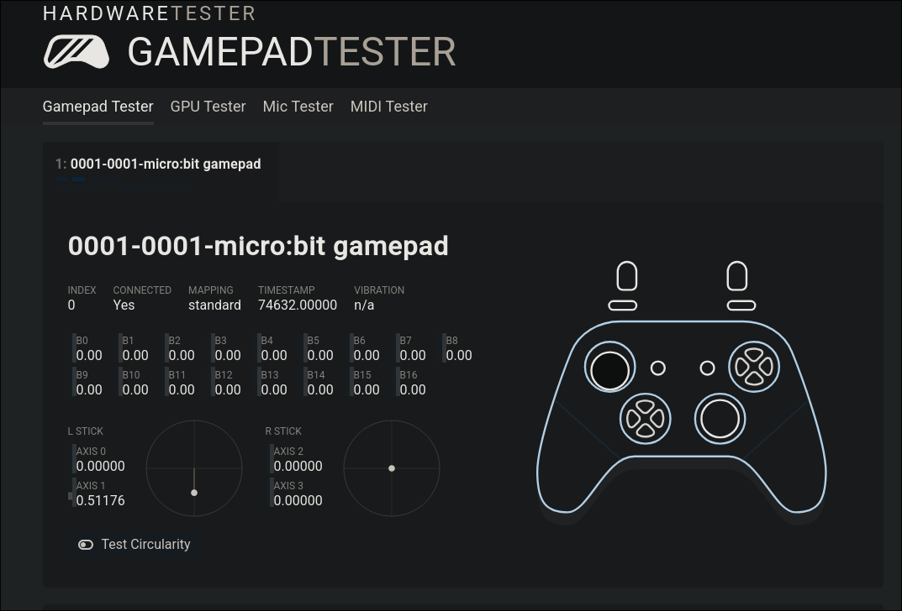

<h1 align="center">microbit_gamepad</h1>

<p align="center">Turn a BBC micro:bit into a game controller for your PC.</p>

<p align="center">
  
  
  
</p>

<p align="center">
  <a href="LICENSE"></a>
  
  
  
  
</p>

---

## What is this

The micro:bit has two buttons, an accelerometer, a touch logo and a 5x5 LED grid. That's a surprisingly decent set of inputs for a tiny controller, so this project aims to make it show up on your computer as a gamepad.

The firmware on the board streams its inputs over USB serial. A small host program reads them and creates a virtual gamepad through uinput, so games and tools see an ordinary controller.



## Mapping

| micro:bit | Gamepad |
| --- | --- |
| Tilt left/right | Left stick X (`ABS_X`) |
| Tilt forward/back | Left stick Y (`ABS_Y`) |
| Button A | `BTN_TL2` (L2) |
| Button B | `BTN_TR2` (R2) |
| Logo touch | `BTN_START` |
| Shake | `BTN_SOUTH` (held for 150 ms, since a shake is momentary) |

The board also gives feedback: a dot on the LED grid follows the tilt, corner pixels light up for A, B and shake, and each button press beeps. Mapping is hardcoded for now, see `gamepad.py` and `firmware/main.py`.

## Quick start

You need [uv](https://docs.astral.sh/uv/) (or any Python 3.10+ with pip), a micro:bit V2 with MicroPython flashed (see [Flashing MicroPython](#flashing-micropython)), and the [Linux permissions](#linux-permissions) set up.

```sh
uv sync
uv run microbit-gamepad install   # copy the firmware onto the board
uv run microbit-gamepad run       # create the virtual gamepad
```

Stop with `Ctrl-C`.

## Usage

```
microbit-gamepad run      [-p PORT] [--deadzone MG] [--full MG] [--invert-x] [--invert-y] [-v]
microbit-gamepad install  [-p PORT]
microbit-gamepad monitor  [-p PORT]
```

- `run` creates the virtual gamepad. `-v` prints every update.
- `install` copies the firmware to the board as `main.py` and resets it.
- `monitor` prints the raw lines coming from the board, handy for debugging.
- The serial port is auto-detected unless you pass `-p`.
- `--deadzone` (default 120) is the tilt in milli-g that is ignored around flat. `--full` (default 800) is the tilt that gives full stick deflection.
- `--invert-x` / `--invert-y` flip an axis.

### Serial protocol

The board sends one line per update, at least every 100 ms as a heartbeat:

```
G <a> <b> <logo> <shake> <x> <y>
```

The first four are `0`/`1`, `x` and `y` are accelerometer readings in milli-g. Lines that don't parse are ignored.

## Tests

```sh
uv run python -m unittest discover tests
```

## Hardware

You need a micro:bit **V2**. The V1 has much less RAM and a different MicroPython build, so I'm not targeting it.

Not sure which one you have? V2 has a gold logo that's touch sensitive, plus a built-in speaker (a small silver square on the back). V1 has neither.

## Flashing MicroPython

The micro:bit ships with whatever the last person put on it, so start by putting MicroPython on. The board shows up as a USB drive and you flash it by copying a `.hex` file onto it, no special tools needed.

### 1. Plug it in

Use a USB cable that carries data. Some charge-only cables will power the board but never show a drive. If nothing appears, try another cable first.

You should see a drive called `MICROBIT`:

```sh
lsblk -o NAME,LABEL,MOUNTPOINT | grep -i microbit
```

On a lot of Linux setups it shows up but isn't mounted. If so:

```sh
udisksctl mount -b /dev/sda   # use whatever device lsblk showed
```

### 2. Get the right hex

Grab the latest `micropython-microbit-v2.x.x.hex` from the
[micropython-microbit-v2 releases](https://github.com/microbit-foundation/micropython-microbit-v2/releases).

```sh
curl -LO https://github.com/microbit-foundation/micropython-microbit-v2/releases/download/v2.1.1/micropython-microbit-v2.1.1.hex
```

Don't use the V1 hex on a V2, it won't work.

### 3. Copy it over

```sh
cp micropython-microbit-v2.1.1.hex /run/media/$USER/MICROBIT/ && sync
```

The yellow LED on the back blinks while it writes. When it's done the drive disappears and comes back on its own. That's normal, it just rebooted into the new firmware.

If the copy gets rejected, check `FAIL.TXT` on the drive, it usually says why.

### 4. Check it worked

Open the REPL over serial. The board shows up as `/dev/ttyACM0`:

```sh
screen /dev/ttyACM0 115200
```

Press `Ctrl-D` to soft reset and you should get the MicroPython banner and a `>>>` prompt. Try:

```python
>>> from microbit import *
>>> display.scroll("hi")
```

Leave `screen` with `Ctrl-A` then `K`.

### Copying code onto the board

`microbit-gamepad install` does this for you using [`mpremote`](https://docs.micropython.org/en/latest/reference/mpremote.html), which is installed with the project. To copy your own file by hand:

```sh
uv run mpremote cp main.py :main.py
```

`main.py` runs automatically every time the board boots.

### Troubleshooting

| Problem | Try this |
| --- | --- |
| No `MICROBIT` drive | Different USB cable. Charge-only cables are everywhere. |
| `Permission denied` on `/dev/ttyACM0` | Add yourself to the `uucp` group (Arch) or `dialout` (Debian/Ubuntu), then log out and back in. |
| Drive shows up but won't mount | `udisksctl mount -b /dev/sdX`, or mount it by hand. |
| Stuck in a weird state | Unplug, then plug in while holding the reset button on the back. |
| `screen` says device busy | Something else has the port open, e.g. `mpremote` or ModemManager. |

## Linux permissions

Creating a virtual gamepad needs write access to `/dev/uinput`, which is root-only by default. Give the `input` group access and add yourself to it:

```sh
sudo cp udev/99-microbit-gamepad.rules /etc/udev/rules.d/
sudo udevadm control --reload && sudo udevadm trigger
sudo usermod -aG input $USER
```

Log out and back in so the new group applies. If `/dev/uinput` still isn't `root input 0660`, run `sudo modprobe uinput` and trigger udev again.

To try it right now without logging out (resets on reboot):

```sh
sudo setfacl -m u:$(id -un):rw /dev/uinput
```

## Repo layout

```
.
├── src/microbit_gamepad/
│   ├── cli.py            # run / install / monitor commands
│   ├── protocol.py       # line parsing and tilt -> axis maths
│   ├── gamepad.py        # uinput virtual gamepad
│   ├── serial_link.py    # finding and reading the serial port
│   └── firmware/main.py  # MicroPython code that runs on the board
├── tests/
├── udev/                 # uinput permission rule
├── screenshots/
├── LICENSE
└── README.md
```

## License

MIT, see [LICENSE](LICENSE).
